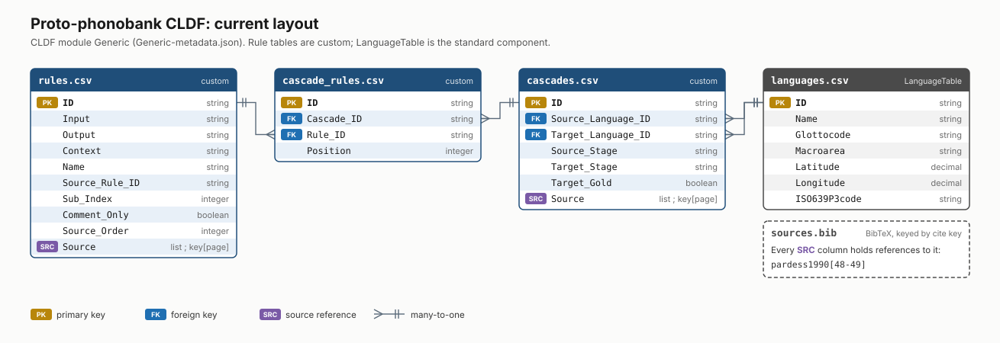
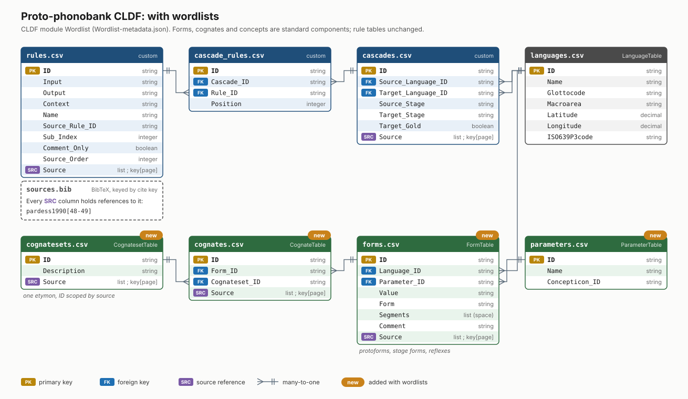

# Building prototype Phonobank CLDF from DiaSim cascades

Doing it the standard DLCE way. The git version-controlled repo is the canonical form of the database. Versioning is then provided by git with commits altho we can have formal versioning and releases later on if we need them.

Raw cascade files are placed into subfolders in `raw/` named after the source, e.g. `pardess1990/`, along with a bibtex file for the reference. Parsing of the cascade format mainly happens in the CLDFbench script, `cldfbench_phonobank.py`, but if cascade-specific processing is needed this happens in individual Python scripts in the `raw/` source directories. This is needed e.g. to process comments with source headings etc. Running `makecldf` then parses the cascades and builds the CLDF.

Here's a diagram of the current layout of the CLDF data tables:

And this is how I expect it will look after we add wordlists:

## General instructions

- Install and generate dataset:
  1. `git clone <uri> && cd phonobank`
  2. `python3.14 -m venv venv && source venv/bin/activate`
  3. `pip install -e .`
  4. `cldfbench makecldf cldfbench_phonobank.py`

- Emit a DiaSim cascade from the dataset for testing:
  1. `cldfbench phonobank.cascade <sourceid> -o <filename>`, e.g. `cldfbench phonobank.cascade pardess1990 -o pardess1990cascade.txt`
  
- Validate a generated DiaSim cascade against its original, pre-CLDF imported form, line by line:
  1. `cldfbench phonobank.check <sourceid>`, e.g. `cldfbench phonobank.check pardess1990`
  
- Use DiaSim to validate a generated DiaSim cascade against a set of forms:

## Todo list
- [ ] Refit Claude cascade extractor or make new extractor to mine sources for protoforms as well as cascades
  - [ ] Then refit the CLDF to include a Formtable, CognateTable and ParameterTable (linked to concepticon) as in the ABVD or similar datasets where cognacy is recorded
  - [ ] Refit `phonobank.compare` command once FormTable exists to use real forms to check that the DiaSim cascade gives the same results

## Issues to consider

- Different authors may have different reconstructions with different proto-phonemes. For example Tsuchida (1978) reconstructs more proto-phonemes for PAn than does Blust (1999 etc). Furthermore, Glottocodes for protolanguages don't completely capture this. So the unique identifier of a protolanguage should be something like author/glottocode

- DiaSim as far as I understand it works on lists of words to test cascades. We start with a list of protoforms, apply the cascade, and verify whether the result matches the true forms for some language. These should probably live in a Lexibank wordlist. Where do we get the lists of protoforms? The sources for the cascades? Clayton or I will work on also extracting wordlists from the source with the LLM at the same time the cascade is generated. So we are going to include wordlists These will live in their own source-keyed wordlists or i.e. in a formstable. and then like how the ABVD does it with cognate coding, we can have a cognatetable which maps source-derived protolanguage to protoform to concept.

- I've made a `etc/languages.csv` to map Glottocodes to source-derived intermediate stages by hand. Because like reconstructions and protophonemes, different authors' intermediate protolanaguages could have different members. For now, including Glottocodes is optional and for the test set of cascades I only added Glottocodes to Italian / Romanian / Latin. One way around this is having a table which maps source-derived intermediate-stage protolanguage to glottocodes in a one-to-many relationship. You could even include lat/lng coordinates with some level of uncertainty if a source decided to commit themselves on where a protolanguage was likely to be spoken, e.g. proto-Polynesian in Samoa

